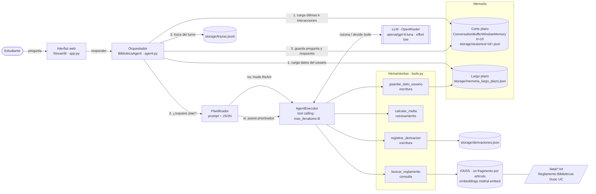

# Asistente Biblioteca Duoc UC · Agente funcional (EP2)

Proyecto de ISY0101 Ingeniería de Soluciones con IA. Continúa el sistema RAG del EP1 sobre el **Reglamento de Bibliotecas Duoc UC** (sede Plaza Norte) y lo transforma en un **agente funcional** con herramientas de consulta, razonamiento y escritura, memoria de corto y largo plazo, planificación y una interfaz web en Streamlit.

Fuente del reglamento: https://bibliotecas.duoc.cl/reglamento

## Problema que resuelve

El reglamento está repartido en secciones (usuarios, préstamos, morosos y sanciones, disciplina, salas, lentes VR) y los estudiantes preguntan una y otra vez por plazos, renovaciones y multas. En el EP1 el asistente solo respondía preguntas aisladas. En el EP2 el agente:

- **recuerda** la conversación y datos estables del estudiante (por ejemplo, si es usuario interno), incluso entre conversaciones distintas;
- **calcula** la multa del Art. 18° con código Python, no con el LLM;
- **planifica** consultas con varias partes y se adapta cuando falta un dato;
- **deriva** a un encargado registrando un ticket cuando el reglamento no responde la consulta (en el EP1 la derivación era solo un mensaje de texto).

El alcance sigue siendo informativo: no realiza préstamos, reservas ni pagos, y no consulta cuentas reales de estudiantes.

## Arquitectura



Diagramas de secuencia, tabla de decisiones y registro de decisiones (ADR) en [`docs/arquitectura.md`](docs/arquitectura.md).

| Componente | Implementación |
|---|---|
| Interfaz | Streamlit (`app.py`): chat, panel con el razonamiento del agente, memoria de largo plazo y tickets |
| Orquestador | `BibliotecaAgent` (`src/biblioteca_agent/agent.py`) |
| Framework | LangChain 1.x: `create_tool_calling_agent` + `AgentExecutor` (paquete `langchain-classic`) |
| LLM | `openai/gpt-6-luna` vía OpenRouter, esfuerzo de razonamiento `low` |
| RAG | FAISS + embeddings `mistral-embed`, un fragmento por artículo (máx. 1.200 caracteres) con sección y número de artículo, top_k = 4, umbral 0.45 |
| Memoria corto plazo | `ConversationBufferWindowMemory(k=10)`, historial guardado en `storage/sesiones/<id>.json` |
| Memoria largo plazo | `storage/memoria_largo_plazo.json`, escrita por la tool `guardar_dato_usuario` |
| Planificación | ReAct por defecto · Plan-and-Execute para consultas compuestas, con detención y replanificación |

### Herramientas

| Tool | Tipo | Qué hace |
|---|---|---|
| `buscar_reglamento(consulta)` | Consulta | RAG sobre el reglamento; devuelve fragmentos con fuente y score, o `SIN_RESPALDO` si el mejor score queda bajo el umbral |
| `calcular_multa(dias_atraso, cantidad_items, tipo_usuario)` | Razonamiento | Art. 18°: $1.000 por cada 7 días de atraso, por ítem, solo usuarios internos |
| `guardar_dato_usuario(dato, valor)` | Escritura | Guarda nombre, tipo_usuario, sede, carrera o preferencia_respuesta. Rechaza datos sensibles (Art. 2°) |
| `registrar_derivacion(consulta, motivo)` | Escritura | Crea un ticket `DER-XXXX` para un encargado en `storage/derivaciones.json` |

El agente elige la herramienta leyendo el nombre, los tipos de los parámetros y el *docstring* de cada función decorada con `@tool`. Para agregar una nueva, basta con escribir otra función con `@tool` en `tools.py` y sumarla a la lista que retorna `build_tools`.

### Memoria

- **Corto plazo:** en cada turno se cargan las **últimas 10 interacciones** (pregunta + respuesta) con `load_memory_variables`, se invoca al agente y se guarda el nuevo par con `save_context`. Así el tamaño del contexto queda acotado y predecible. El historial completo de la sesión queda en disco, por lo que no se pierde si se reinicia la aplicación.
- **Largo plazo:** cuando el estudiante menciona un dato estable ("soy alumno", "soy de Plaza Norte"), el agente lo guarda con `guardar_dato_usuario`. Esos datos se inyectan en el prompt de sistema de cada turno y de cada nueva conversación del mismo usuario, por lo que no vuelve a preguntarlos.
- **Recuperación semántica de contexto:** el conocimiento del reglamento se recupera por similitud de embeddings (FAISS) en cada consulta.

### Planificación y toma de decisiones

1. Un **planificador** (LLM + prompt) decide si la consulta tiene dos o más necesidades distintas.
2. **Consulta simple → ReAct:** el agente razona, llama tools, observa y repite hasta responder (máximo 8 iteraciones, para evitar ciclos infinitos). Si los fragmentos no responden, vuelve a buscar con otras palabras antes de derivar.
3. **Consulta compuesta → Plan-and-Execute:** los pasos se ordenan por prioridad (normas → cálculos → escritura) y cada paso recibe los resultados de los anteriores. Si un paso necesita un dato que el usuario no entregó, responde `FALTA_DATO`: el plan se detiene, se le pregunta al usuario y en el turno siguiente se vuelve a planificar con el dato nuevo.

## Estructura

```
Agente_Rag_Biblioteca/
├── app.py                        # Interfaz Streamlit
├── src/biblioteca_agent/
│   ├── config.py                 # Configuración desde .env
│   ├── rag.py                    # Carga, chunking, FAISS persistido, umbral
│   ├── tools.py                  # Herramientas del agente
│   ├── memory.py                 # Memoria corto/largo plazo y derivaciones
│   ├── prompts.py                # Prompts del agente, planificador y síntesis
│   └── agent.py                  # Orquestación ReAct + Plan-and-Execute
├── tests/                        # Pruebas automáticas (sin red, sin gastar la API key)
├── scripts/
│   ├── calibrar_umbral.py        # Scores dentro/fuera de alcance (solo embeddings)
│   ├── golden_set.json           # Preguntas con respuesta esperada
│   └── evaluar_golden_set.py     # Evaluación end-to-end con el modelo real
├── docs/                         # Arquitectura, diagramas y evidencia
├── data/                         # Reglamento en 6 documentos temáticos
├── notebook/                     # Notebook del EP1 (referencia)
├── storage/                      # Generado en ejecución (ignorado por git)
├── .env.example
└── requirements.txt
```

## Instalación

Requisitos: Python 3.10 o superior, la API key de OpenRouter del grupo y una API key de Mistral (embeddings).

```bash
git clone https://github.com/Abraham1439/Agente_Rag_Biblioteca.git
cd Agente_Rag_Biblioteca

# Crear y activar entorno virtual
python -m venv .venv
.venv\Scripts\activate          # Windows (PowerShell)
source .venv/bin/activate       # macOS / Linux

pip install -r requirements.txt
```

Configurar las claves copiando el ejemplo:

```bash
copy .env.example .env          # Windows
cp .env.example .env            # macOS / Linux
```

En `.env`, reemplazar `OPENROUTER_API_KEY` y `EMBEDDING_API_KEY` por las claves reales. **`.env` está en `.gitignore`: nunca subir las claves al repositorio.**

## Ejecución

```bash
streamlit run app.py
```

Se abre en http://localhost:8501. La primera ejecución genera el índice FAISS (`storage/faiss_index`); las siguientes lo cargan desde disco. Si cambian los documentos, `CHUNK_SIZE`, `CHUNK_OVERLAP` o el modelo de embeddings, el índice se regenera automáticamente.

### Guion de demo

1. `Hola, soy alumno de la sede Plaza Norte` → guarda `tipo_usuario` y `sede` (se ven en la barra lateral).
2. `Devolví 2 libros con 15 días de atraso, ¿cuánto pago?` → ReAct: `buscar_reglamento` + `calcular_multa` → $4.000 (Art. 18°).
3. **Nueva conversación** → `Me atrasé 7 días con un libro, ¿cuánto pago?` → no pregunta si es interno: lo recuerda de la memoria de largo plazo.
4. `Perdí un libro y tengo otro atrasado, ¿qué hago y cuánto pago?` → Plan-and-Execute: el paso de la multa se bloquea porque faltan los días de atraso y el agente los pregunta.
5. `¿La biblioteca vende café?` → el reglamento no lo cubre → el agente lo reconoce y registra un ticket de derivación (visible en la barra lateral).

El panel **"Cómo lo resolvió el agente"** muestra el modo usado (ReAct o Plan-and-Execute), los pasos del plan con su estado y cada llamada a herramientas con su resultado.

## Pruebas

```bash
pytest -q
```

29 pruebas que **no usan red ni gastan la API key**: los embeddings son falsos (`DeterministicFakeEmbedding`) y el LLM es un modelo falso que devuelve respuestas predefinidas, incluidas llamadas a herramientas. Cubren:

- `calcular_multa`: casos límite (6, 7, 15 y 21 días), usuarios externos y validación de entradas.
- Memoria: la ventana envía solo las últimas k interacciones, el historial sobrevive a un reinicio, las sesiones no se mezclan y la memoria de largo plazo persiste, valida y rechaza datos sensibles.
- RAG: un fragmento por artículo sin fragmentos de solo encabezado, Art. 15° completo, división de artículos largos conservando el encabezado, índice que se regenera si cambian los datos o el chunking, `SIN_RESPALDO` bajo el umbral.
- Agente: modo ReAct con llamada a tools, memoria de largo plazo entre sesiones, Plan-and-Execute completo y plan detenido por un dato faltante.

Con el modelo real (gasta presupuesto; ejecutar solo para la evidencia final):

```bash
python scripts/calibrar_umbral.py     # solo embeddings de Mistral
python scripts/evaluar_golden_set.py  # 8 casos, exige 80 % de aprobación
```

`evaluar_golden_set.py` guarda los resultados en `docs/evidencia/golden_set_resultados.json`.

## Configuración

Todo es configurable desde `.env`, sin tocar código: modelo, esfuerzo de razonamiento, timeout, parámetros RAG (`CHUNK_SIZE`, `CHUNK_OVERLAP`, `TOP_K`, `SCORE_THRESHOLD`), tamaño de la ventana de memoria (`MEMORY_WINDOW_K`), máximo de iteraciones del agente (`AGENT_MAX_ITERATIONS`) y carpeta de almacenamiento (`STORAGE_DIR`).

## Limitaciones

- Los TXT de `data/` no incluyen el Art. 16° del reglamento (heredado del EP1).
- Los archivos JSON de memoria y tickets sirven para el prototipo, pero no para muchos usuarios simultáneos; en producción se usaría una base de datos.
- El usuario se identifica con un texto en la barra lateral, sin autenticación.
- Los documentos de `data/` no se sincronizan con el sitio oficial: si cambia el reglamento, hay que actualizar los TXT; el índice se regenera solo al detectar el cambio.
- El modo plan usa más llamadas al LLM (planificador, pasos y síntesis) que el modo ReAct.
- `calcular_multa` cobra por bloques completos de 7 días (lectura literal del Art. 18°).
- `AgentExecutor` y `ConversationBufferWindowMemory` están marcados como deprecados en LangChain 1.x (ver ADR-01).

## Referencias

Duoc UC. (2025). *Reglamento de Bibliotecas Duoc UC*. https://bibliotecas.duoc.cl/reglamento

LangChain. (s. f.). *LangChain Python documentation*. https://python.langchain.com

Mistral AI. (s. f.). *Mistral AI API documentation*. https://docs.mistral.ai

OpenRouter. (s. f.). *OpenRouter API reference*. https://openrouter.ai/docs

Streamlit. (s. f.). *Streamlit documentation*. https://docs.streamlit.io

Yao, S., Zhao, J., Yu, D., Du, N., Shafran, I., Narasimhan, K., & Cao, Y. (2023). ReAct: Synergizing reasoning and acting in language models. *International Conference on Learning Representations*. https://arxiv.org/abs/2210.03629

## Uso de Inteligencia Artificial

> **Completar por el equipo:** declarar qué herramientas de IA se usaron y para qué, según la pauta (https://bibliotecas.duoc.cl/ia).
