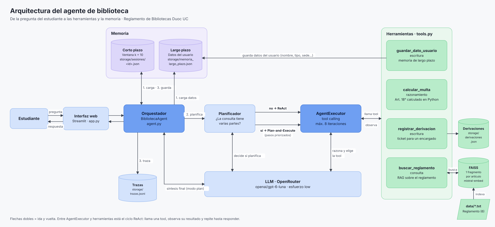
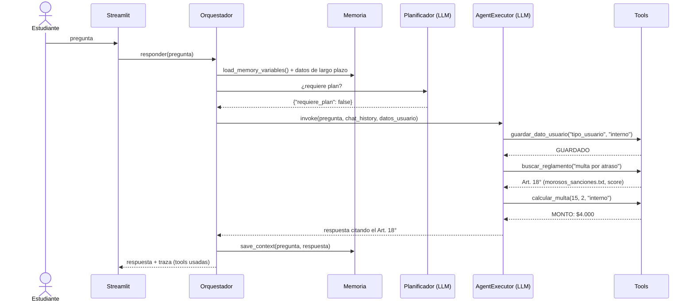
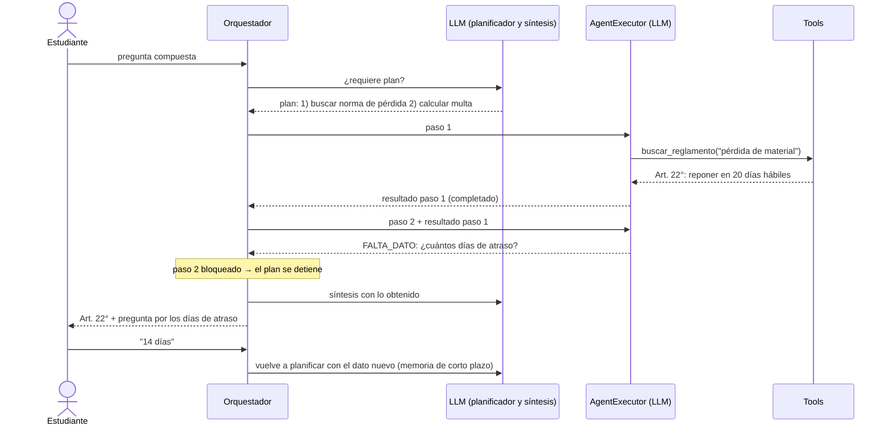

# Arquitectura y orquestación del agente (EP2)

## 1. Diagrama de componentes

| Capa | Componentes | Qué hace |
|---|---|---|
| Interfaz | Streamlit (`app.py`) | Recibe la pregunta del estudiante y le devuelve la respuesta |
| Orquestación | Orquestador (`BibliotecaAgent`), Planificador, `AgentExecutor` | Carga la memoria, decide si usar ReAct o Plan-and-Execute y ejecuta el turno |
| Modelo | LLM `openai/gpt-6-luna` vía OpenRouter | Lo usan el planificador (decide si planifica), el `AgentExecutor` (razona y elige la tool) y el orquestador (síntesis final del modo plan) |
| Herramientas | `buscar_reglamento`, `calcular_multa`, `guardar_dato_usuario`, `registrar_derivacion` | Consulta, razonamiento y escritura; entre el `AgentExecutor` y las tools ocurre el ciclo ReAct (llama una tool, observa el resultado y repite) |
| Datos | Memoria de corto y largo plazo, índice FAISS, derivaciones, trazas | Persisten en `storage/`; el reglamento se indexa desde `data/*.txt` |

## 2. Flujo de un turno

1. **Cargar memoria**: últimas 10 interacciones de la sesión (corto plazo) y datos guardados del usuario (largo plazo, se inyectan en el prompt de sistema).
2. **Planificar**: el planificador decide si la consulta tiene dos o más necesidades distintas.
   - **No** → **ReAct**: el `AgentExecutor` razona, llama tools y observa el resultado en ciclo hasta responder (máximo 8 iteraciones); si los fragmentos no responden, reformula la búsqueda antes de derivar.
   - **Sí** → **Plan-and-Execute**: se ejecutan los pasos en orden (normas → cálculos → escritura), pasando los resultados anteriores como contexto a cada paso. Si un paso necesita un dato que el usuario no entregó (`FALTA_DATO`), el plan se detiene, se pregunta al usuario y en el turno siguiente se vuelve a planificar con el dato nuevo (replanificación).
3. **Guardar**: pregunta y respuesta final en la memoria de corto plazo y traza del turno en `trazas.jsonl`.

## 3. Diagrama de secuencia · consulta simple (ReAct)

"Soy alumno, devolví 2 libros con 15 días de atraso, ¿cuánto pago?"

## 4. Diagrama de secuencia · consulta compuesta (Plan-and-Execute con condición cambiante)

"Perdí un libro y tengo otro atrasado, ¿qué hago y cuánto pago?"

## 5. Tabla de decisiones

| Condición | Comportamiento del agente | Componente / herramienta |
|---|---|---|
| Pregunta sobre una norma (préstamos, salas, sanciones, VR) | Busca en el reglamento y responde citando el artículo | ReAct · `buscar_reglamento` |
| La pregunta tiene dos temas o los fragmentos no la responden | Hace una búsqueda corta por tema y reformula (máx. 2 veces) antes de derivar | Prompt (reglas 1 y 6) |
| Pregunta por un monto de multa con todos los datos | Calcula en Python, no en el LLM | ReAct · `calcular_multa` |
| Falta un dato para calcular (días, ítems, tipo de usuario) | Pregunta al usuario en vez de suponer | Prompt (regla 5) / `FALTA_DATO` en modo plan |
| El usuario ya dijo antes que es interno (otra sesión) | No vuelve a preguntar, usa el dato guardado | Memoria de largo plazo |
| Usuario externo pregunta por multa | Informa que el Art. 18° solo aplica a usuarios internos | `calcular_multa` → `NO_APLICA` |
| El usuario menciona nombre, tipo de usuario, sede, carrera o preferencia | Lo guarda para futuras conversaciones | `guardar_dato_usuario` |
| El usuario entrega RUT u otro dato sensible | No lo guarda (Art. 2°, privacidad) | `guardar_dato_usuario` → `ERROR` |
| Mejor score de recuperación bajo el umbral | Indica que no hay respaldo y crea un ticket | `buscar_reglamento` → `SIN_RESPALDO` → `registrar_derivacion` |
| La consulta tiene dos o más necesidades distintas | Planifica y ejecuta paso a paso, en orden de prioridad | Planificador + Plan-and-Execute |
| El ciclo ReAct no converge | Se detiene a las 8 iteraciones | `AgentExecutor(max_iterations=8)` |

## 6. Registro de decisiones de arquitectura (ADR)

**ADR-01 · LangChain (`AgentExecutor` + tool calling) como framework.** *Aceptada.* Es el framework visto en clases y el usado en el EP1, lo que permite reutilizar el pipeline RAG. Se usa *function calling* nativo en lugar de parsear texto ReAct con expresiones regulares, porque devuelve JSON estructurado y evita errores de formato. *Consecuencia:* en LangChain 1.x `AgentExecutor` y las clases de memoria están en el paquete `langchain-classic` y aparecen como deprecadas; funcionan, pero una migración futura apuntaría a `create_agent` con *checkpointer*.

**ADR-02 · Memoria de corto plazo con `ConversationBufferWindowMemory` (k = 10).** *Aceptada.* El asistente atiende consultas puntuales (tipo soporte), donde lo relevante son las últimas interacciones. La ventana mantiene un tamaño de contexto predecible y conserva el detalle literal de esas interacciones. Se descartó `ConversationBufferMemory` (crece sin límite) y `ConversationSummaryMemory` (llamada extra al LLM por turno y pérdida de detalles como montos o plazos). *Consecuencia:* lo más antiguo que la ventana olvida se compensa con la memoria de largo plazo. El historial completo se guarda en disco (`storage/sesiones/<id>.json`) para no perderlo si se reinicia la aplicación, aunque solo las últimas 10 interacciones se envían al modelo.

**ADR-03 · Memoria de largo plazo como archivo JSON escrito por una tool.** *Aceptada.* El agente decide qué guardar con `guardar_dato_usuario`. Solo se aceptan cinco datos útiles para aplicar el reglamento (nombre, tipo de usuario, sede, carrera, preferencia de respuesta) y se rechazan identificadores personales (Art. 2°). *Consecuencia:* un JSON es suficiente para el prototipo, pero no soporta concurrencia de muchos usuarios; en producción se reemplazaría por una base de datos.

**ADR-04 · ReAct por defecto y Plan-and-Execute solo para consultas compuestas.** *Aceptada.* ReAct se adapta paso a paso y es suficiente para preguntas simples. Para consultas con varias necesidades, un plan explícito ordena los pasos por prioridad (normas → cálculos → escritura) y deja visible el razonamiento. El plan es estático durante la ejecución; para mitigarlo, se detiene ante un dato faltante y se vuelve a planificar en el turno siguiente. *Consecuencia:* el modo plan cuesta más llamadas al LLM (planificador + pasos + síntesis).

**ADR-05 · Cálculo de multas en una tool de Python.** *Aceptada.* Los LLM no son confiables en operaciones matemáticas, así que la fórmula del Art. 18° vive en código probado con tests unitarios. *Supuesto:* se cobra por bloque completo de 7 días ("$1.000 por cada 7 días de atraso"); si la biblioteca cobra también los bloques incompletos, basta cambiar una línea.

**ADR-06 · Herramientas dentro del mismo proceso (no MCP por ahora).** *Aceptada.* Hay un solo agente y ninguna tool se comparte con otros sistemas, por lo que separarlas agregaría infraestructura sin beneficio. Si otras aplicaciones de Duoc necesitaran `buscar_reglamento`, se expondría en un servidor MCP aparte y el agente la descubriría con su nombre, descripción y esquema de parámetros, sin cambiar el resto del código.

**ADR-07 · OpenRouter con `openai/gpt-6-luna` y esfuerzo de razonamiento bajo.** *Aceptada.* Es el modelo que recomendó el docente por la relación precio-calidad, y cada grupo cuenta con 1 USD de presupuesto. Los tests usan un LLM falso para no gastar ese presupuesto durante el desarrollo.

**ADR-08 · Un fragmento por artículo en lugar de cortar por caracteres.** *Aceptada (reemplaza el chunking del EP1).* En pruebas con el modelo real, la pregunta "¿cómo pido un libro y cuánto tiempo tengo para devolverlo?" se derivó a un encargado aunque la respuesta está en los Art. 11° y 15°: el corte de 500 caracteres generaba fragmentos con solo el encabezado del archivo ("REGLAMENTO… DE LOS PRÉSTAMOS", score 0.82) o solo "Artículo 1°", que ocupaban el top_k, y partía el Art. 15° dejando su segunda mitad sin número de artículo. Ahora cada artículo es un fragmento completo, encabezado con su sección y número (también guardado como metadato para citarlo), top_k sube de 3 a 4 y el prompt pide una búsqueda corta por tema. *Consecuencia:* fragmentos más largos (máx. 1.082 caracteres) y 34 en total; si un artículo supera `CHUNK_SIZE`, se divide conservando el encabezado.